# Finance Tracker by Email

> Versi bahasa Indonesia: [README.md](README.md)

Automatically record expenses from bank/e-wallet notification emails, store
them in Google Sheets, and display them as a dashboard.
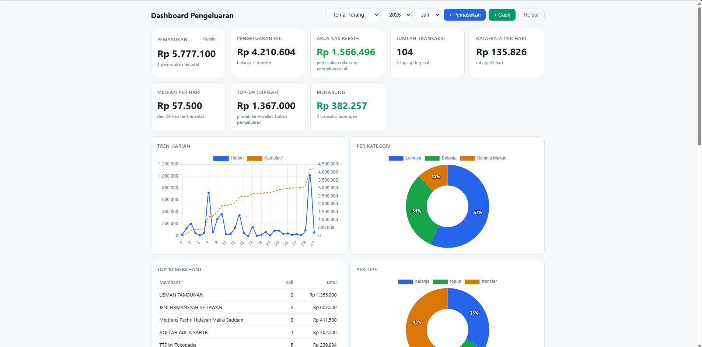

**Flow:** Gmail → Apps Script (parse) → Spreadsheet → Dashboard web app.

**Supported sources:**

| Source | Email | Result |
|---|---|---|
| Livin' by Mandiri | `noreply.livin@bankmandiri.co.id` | spending / top-up / transfer |
| wondr by BNI | `wondr@bni.co.id` | top-up / spending (VA) / transfer |
| Bibit | `no-reply@bibit.id` | savings (mutual funds, kept separate from expenses) |
| GoPay | `no-reply@customers.go-pay.co.id` | bill receipts (e.g. PLN Token → spending, merged with the bank transfer that has the same amount + date) |

**Project files:**

| Local file | Becomes in Apps Script |
|---|---|
| `Parser.js` | script file `Parser` |
| `dashboard.js` | script file `dashboard` |
| `index.html` | HTML file `Index` (the name must be exactly `Index`) |

---

## Prerequisites

- A Google account + Gmail that receives the transaction notifications.
- Email notifications for Livin' / wondr / Bibit / GoPay turned on.
- (Optional, method B) Node.js + `clasp` if you want to push from your machine.

## Usage from scratch

### 1. Create an empty spreadsheet

Create a new Google Sheets file. This becomes the database (all tabs are
created automatically by `setup()`).


### 2. Open Apps Script

In the spreadsheet: **Extensions → Apps Script**. This project **must be bound**
(attached to the spreadsheet) because the code uses `getActiveSpreadsheet()`.

Don't create a standalone project from script.google.com!

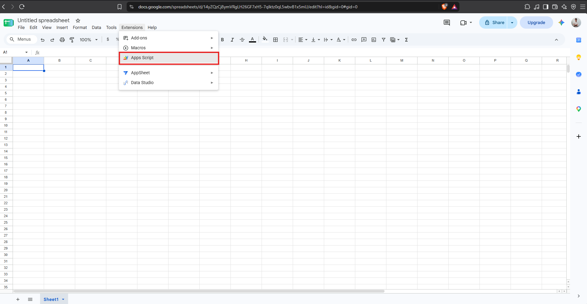

### 3. Add the 3 project files (pick one method)

#### Method A — copy-paste (easiest)

1. Replace the contents of `Code.gs` with the contents of `Parser.js`, then
   rename the file to `Parser` (click the three dots → Rename).
2. `+` button → **Script** → name it `dashboard` → paste the contents of `dashboard.js`.
3. `+` button → **HTML** → name it `Index` → paste the contents of `index.html`.
4. Save (Ctrl+S).

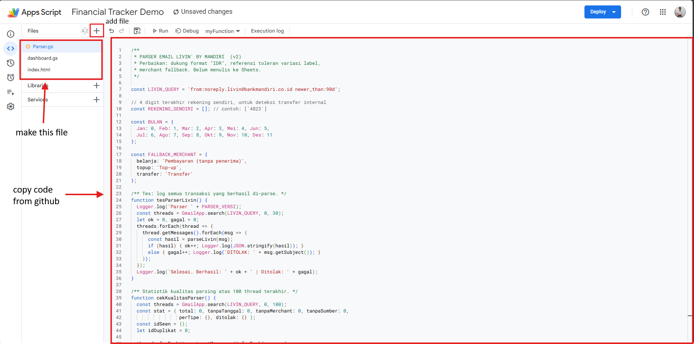

#### Method B — `clasp push` (like importing, no copy-paste)

```bash
npm i -g @google/clasp
clasp login
```

Grab the **Script ID** from Project Settings in Apps Script, then:

```bash
clasp clone <SCRIPT_ID>
# copy Parser.js, dashboard.js, index.html into that folder, then:
clasp push
```

`.js` files automatically become script files, `.html` becomes an HTML file.
After that: edit locally → `clasp push` again.

### 4. Run `setup()` — once

Select the `setup` function → **Run**. Approve the requested access (Gmail read,
Sheets). This creates 8 tabs + column formatting + category seeds:

- `transaksi` — all Livin + wondr + GoPay transactions (categories are computed
  when the dashboard opens, not stored).
- `pemasukan` — income, entered manually from the dashboard.
- `manual` — manual cash transactions (added + deletable from the dashboard).
- `catatan` — free-form notes per email transaction (added from the dashboard).
- `tabungan` — Bibit mutual-fund purchases.
- `config` — `kategori, kata_kunci` rules (feel free to edit).
- `koreksi` — per-merchant category corrections (filled from the dashboard).
- `log_ditolak` — emails that failed to parse + the reason.

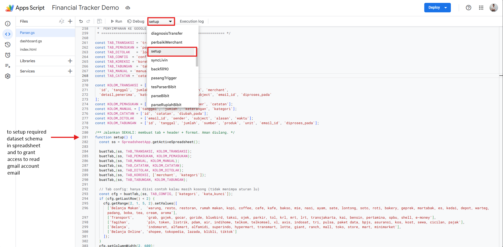

### 5. Test the parsers first

Run `tesParserLivin` / `tesParserWondr` / `tesParserBibit` / `tesParserGoPay`,
then check the **Log**. You should see JSON lines per transaction + a summary
`Berhasil: X | Ditolak: Y` (Succeeded / Rejected). If 0 succeed, don't move on
to syncing — check the email format / tell whoever wrote the parser.

### 6. Pull history

| Coverage | Functions |
|---|---|
| Last 90 days | `backfill90`, `backfillWondr90`, `backfillBibit90`, `backfillGoPay90` |
| ±3 years at once | `backfillSemuaLivin`, `backfillSemuaWondr`, `backfillSemuaBibit`, `backfillSemuaGoPay` |

Dedup is by transaction id, so re-running is safe. A GoPay receipt whose amount +
date match a bank transaction is merged into one (no double counting). If you hit
`Exceeded maximum execution time` (thousands of emails in history), split per year:
`syncLivin(365)`, then `syncLivin(365, 365)`, then `syncLivin(365, 730)`
(same pattern works for `syncWondr` / `syncBibit` / `syncGoPay`).

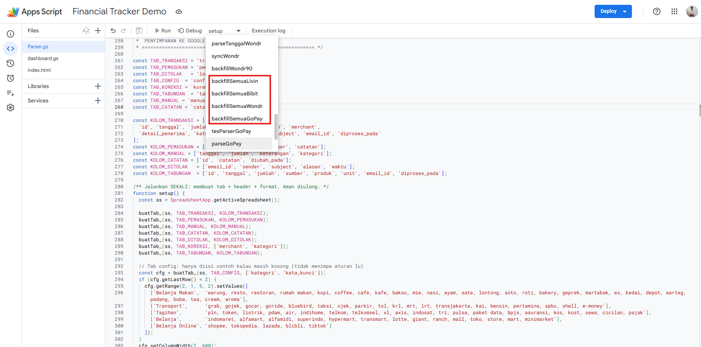

### 7. Automation — run `pasangTrigger()` once

From now on `syncLivin` + `syncBibit` + `syncWondr` + `syncGoPay` run by themselves
every 6 hours (incremental, only fetching new emails). Re-running is safe anytime —
old triggers are deleted before new ones are created, so they never double up.

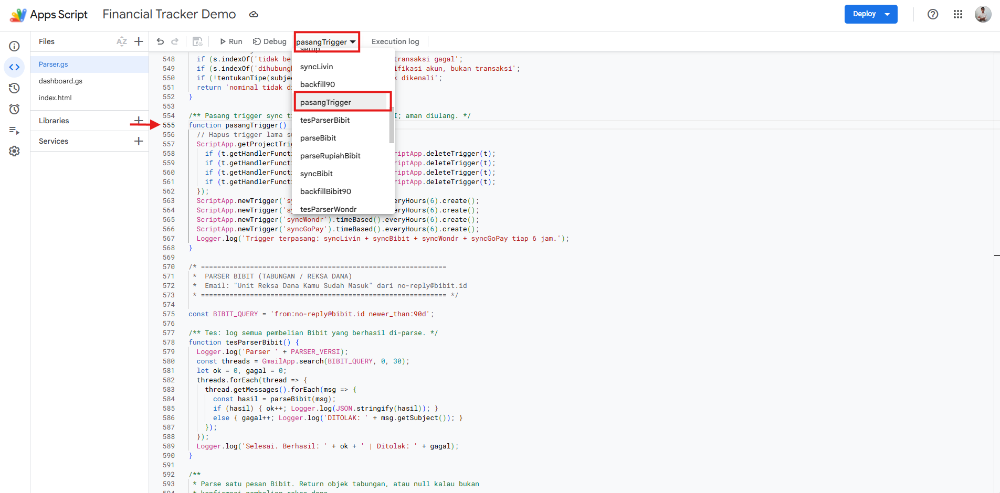

### 8. Deploy the dashboard

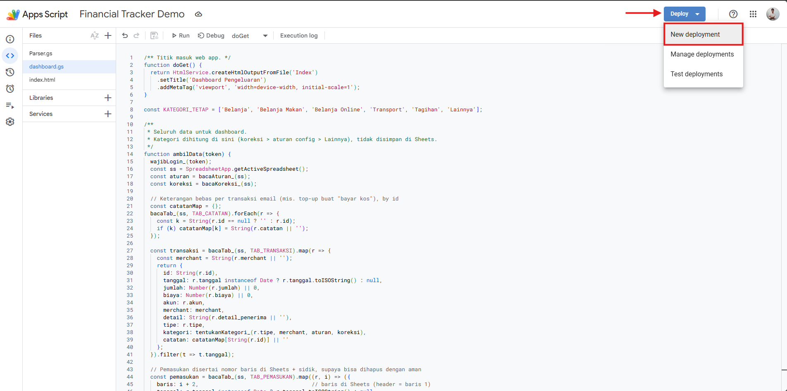
**Deploy → New deployment → Web app** → Execute as: *Me* → Who has access:
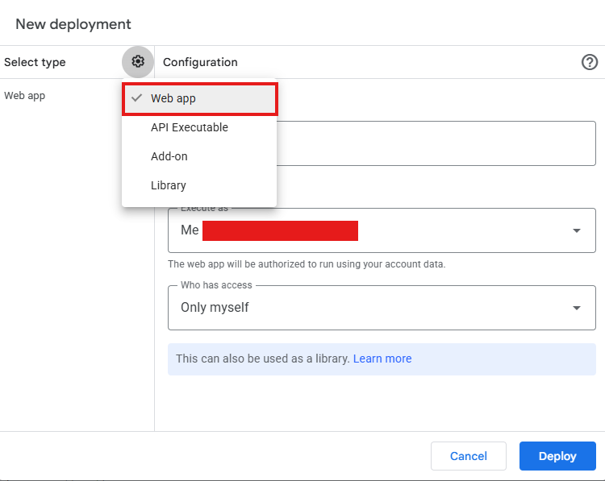
*Only myself* (personal dashboard) → Deploy → open the URL.
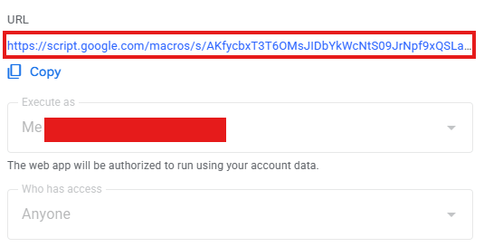

> Every time you change the code: **Manage deployments → edit (pencil icon) →
> New version**. Otherwise the dashboard keeps running the old version.


### 9. Create a login account (once)

The dashboard sits behind a login page (username + password). Credentials are
**never written in the code or the Sheets** — they're stored as a SHA-256 hash +
salt in ScriptProperties.

1. In Apps Script, run the **`buatAkun()`** function → fill in the username,
   password (min 6 characters), and recovery email via the prompts that pop up.
> Note: when you run buatAkun(), a pop-up appears in the spreadsheet asking for
> the username and password
> fill those in — they're what you'll use to log in to the dashboard
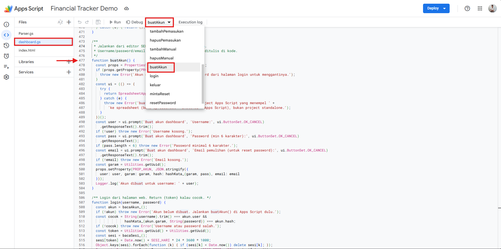
3. Open the dashboard URL → log in.
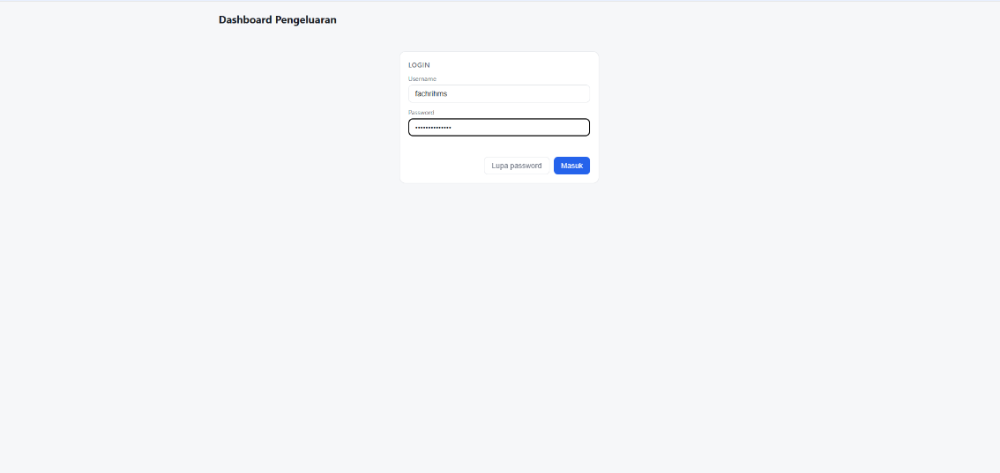
4. Forgot password → click **Lupa password** → a 6-digit code (valid for
   15 minutes) is sent to the recovery email → exchange it for a new password.

Login sessions last 7 days (stored in the browser). The **Keluar** (Log out)
button in the header logs out manually. Every data function rejects requests
without a valid session token.

> Note: this is an application-level lock for personal use. For an extra layer,
> keep Who has access = *Only myself* (Google login) at deploy time.

---

## What's in the dashboard

- **Year** (2024–current year) + **Month** (Jan–Dec) dropdowns.
- KPIs: Income · Real expenses · **Net cash flow**
  (= income − real expenses) · Transaction count ·
  Daily average & **daily median** (median resists outliers, computed from days
  with transactions) · Top-up · Savings.
- Per-category & per-type charts + percent labels, Top 10 merchants.
- **Top-up e-wallet** card: DANA / GoPay / ShopeePay / OVO / LinkAja breakdown
  with brand colors + function notes. **Clickable** to see transaction details
  per wallet. Each transaction's type can be changed:
  **Belanja/Transfer (expense)** vs **Top-up (stored)** + its category
  + a free-form note — ones switched to expense stay listed here.
- **Savings history** card: savings list from incoming emails (e.g. Bibit),
  grouped per mutual-fund product. **Clickable** to see each transaction's detail.
- All-transactions table + filters + **per-transaction type editing**
  (directly updates the `tipe` column in the `transaksi` tab, syncs never overwrite it)
  + **free-form notes per transaction** (e.g. a top-up for "bayar kos",
  stored in the `catatan` tab, searchable via the filter box)
  + **per-merchant category corrections**
  (stored in the `koreksi` tab, applies to every transaction of that merchant).
  Above the table there's a **Last updated** note per source
  (Livin / wondr / Bibit / GoPay) — taken from the last sync time.
- Add / delete manual income right from the dashboard.

## Categories & keywords

Priority: **manual corrections > `config` rules**. A `belanja`-type transaction
that matches no keyword automatically becomes `Belanja`.

Edit the `config` tab however you like (`kata_kunci` separated by commas,
lowercase). Row order = check order, so keep `Belanja Makan` above `Belanja`
so `martabak` doesn't get eaten by the `mart` keyword.

## Function cheat sheet

**Safe to run manually (no required parameters):**
`setup` · `tesParser*` · `backfill*` / `sync*` · `pasangTrigger`

**Don't run manually (helpers, called by other functions):**
`parse*` · `ambil*` · `cari*` · `tentukan*` · anything ending in `_`
(they need an email-object parameter).

## Builder notes
Open the dashboard link in incognito mode if the browser has
more than one gmail account logged in

## Troubleshooting

| Symptom | Check |
|---|---|
| Transaction missing | the `log_ditolak` tab, `alasan` column |
| Code changed but dashboard looks the same | you haven't deployed a **New version** yet |
| Triggers running twice | run `pasangTrigger()` again (idempotent) |
| Failed email / failed transaction | automatically rejected, not an error |
| Need history > 90 days | `backfillSemua*` / chunked `syncX(365, offset)` |
